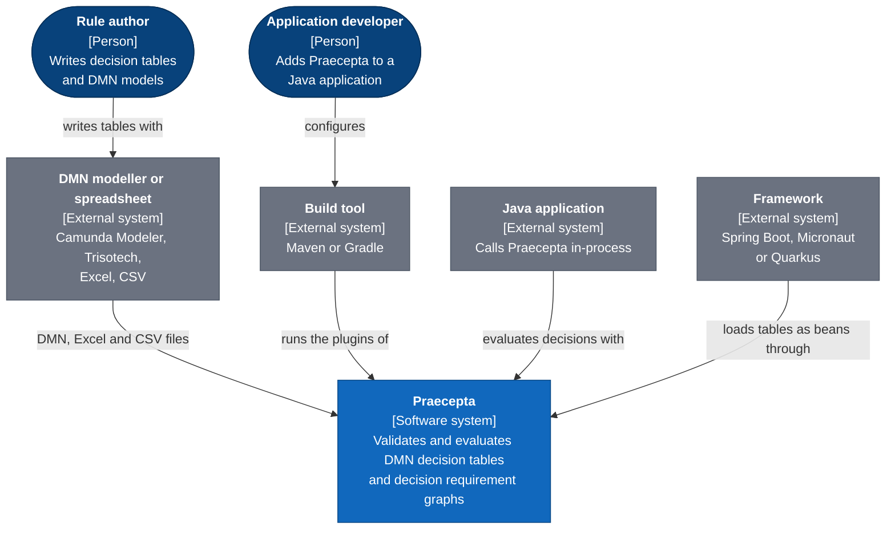
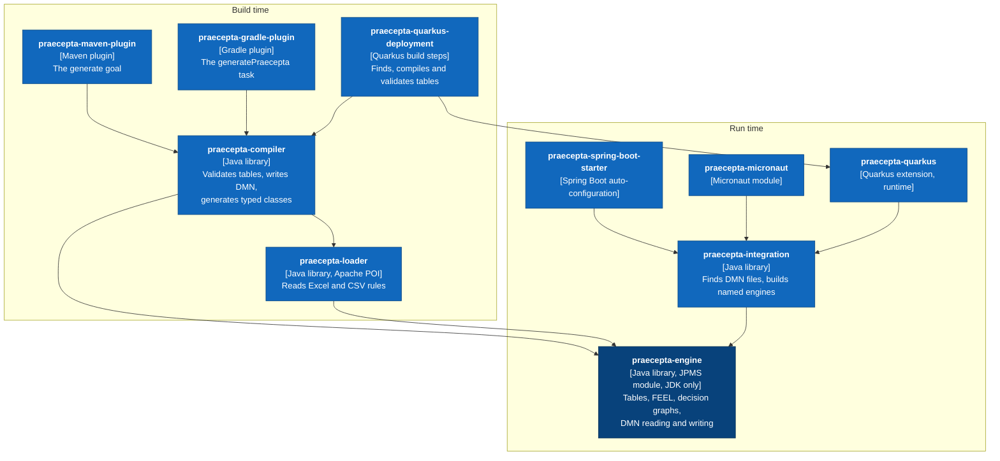
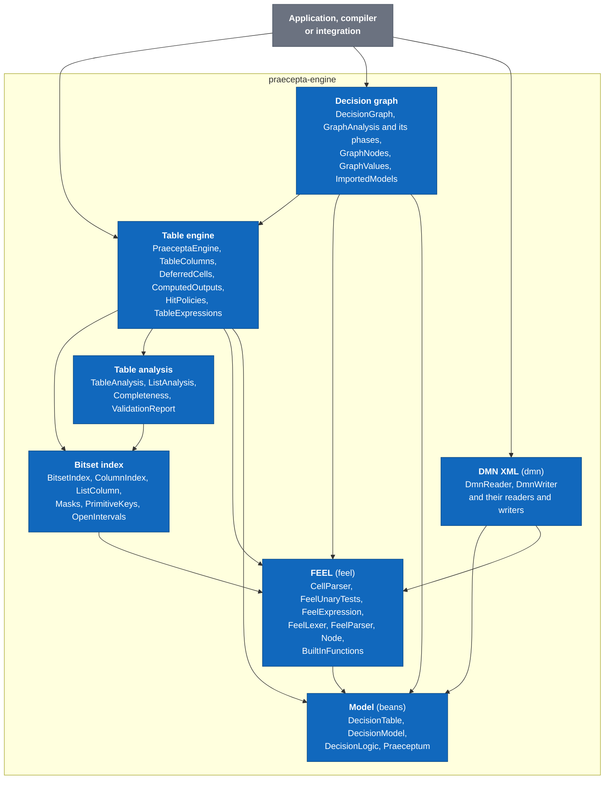
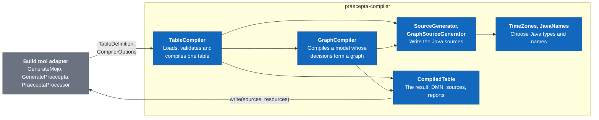
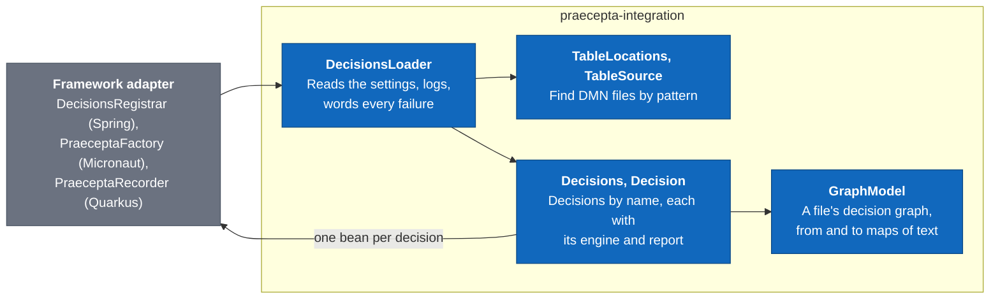
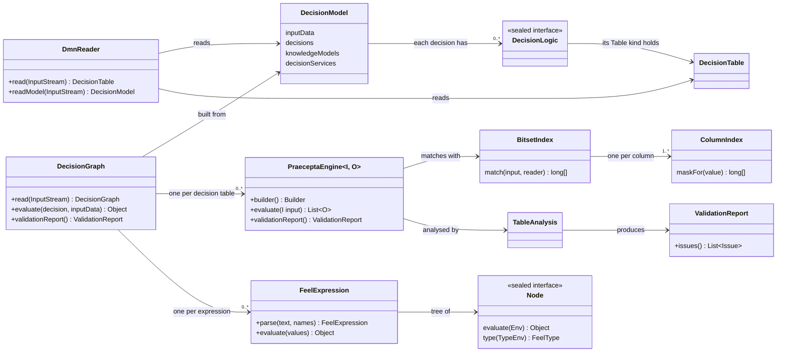
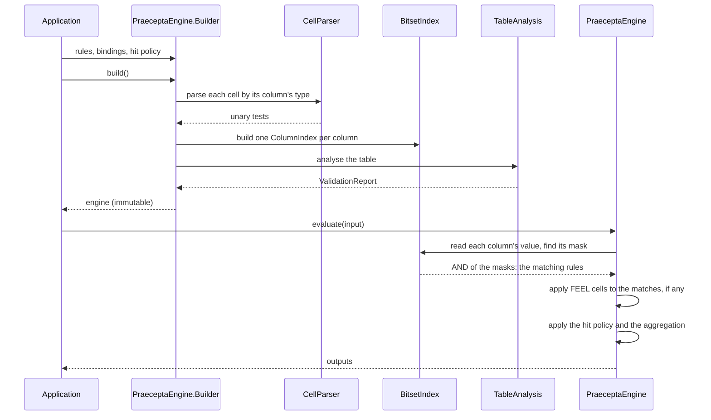
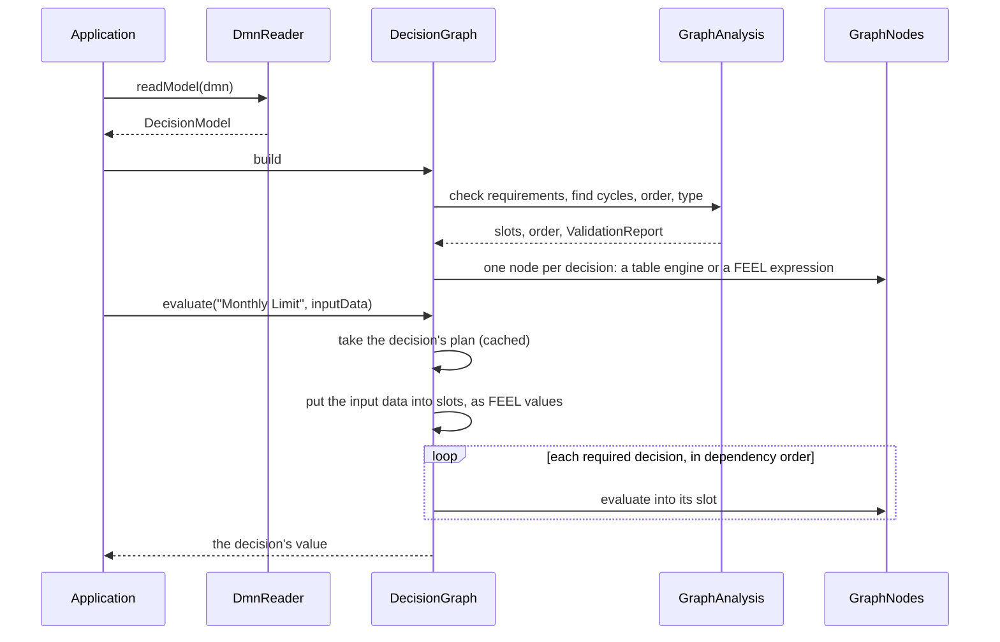
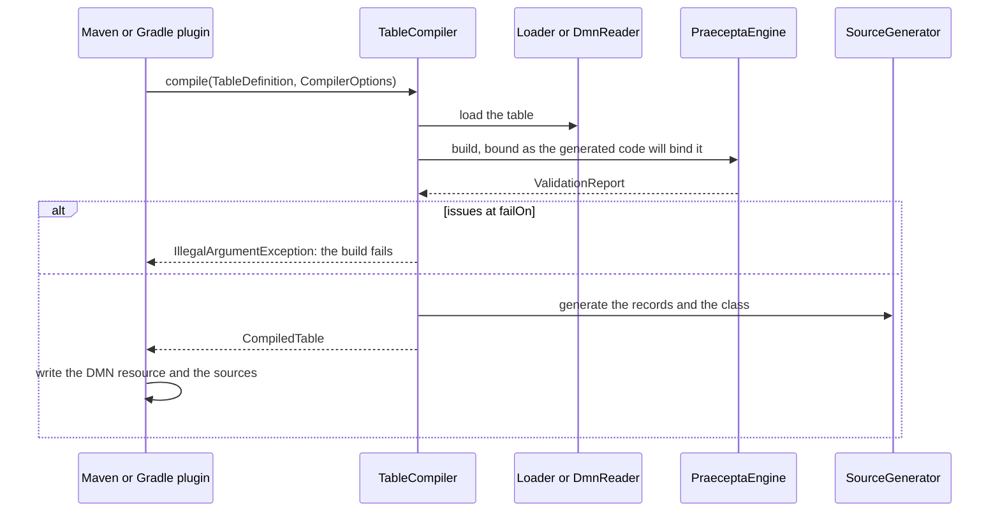
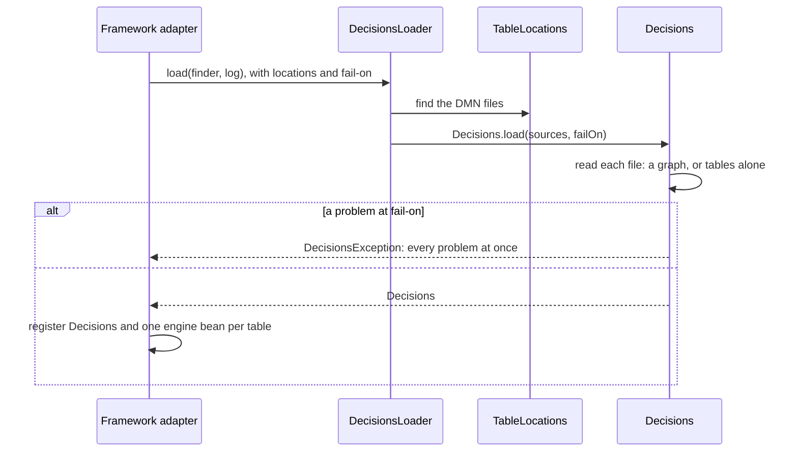

<!--
SPDX-FileCopyrightText: Bruno Pacheco

SPDX-License-Identifier: Apache-2.0
-->

# Architecture

Praecepta is a library, not a service. An application builds an engine or a decision graph once, and
calls it from any thread.

This document describes how the project is built, following the [C4 model](https://c4model.com): system
context, containers, components and code, then the main flows. It does not describe DMN itself. For
what a DMN feature means, read the [DMN 1.5 specification](https://www.omg.org/spec/DMN/1.5/) and the
[DMN TCK](https://github.com/dmn-tck/tck); [DMN features and where they live](#dmn-features-and-where-they-live)
maps each feature to its code and its TCK test cases.

- [Level 1: system context](#level-1-system-context)
- [Level 2: containers](#level-2-containers)
- [Level 3: components](#level-3-components)
- [Level 4: code](#level-4-code)
- [Dynamic views](#dynamic-views)
- [The bitset index](#the-bitset-index)
- [DMN features and where they live](#dmn-features-and-where-they-live)
- [Design decisions](#design-decisions)
- [Quality gates](#quality-gates)

## Level 1: system context
Who and what Praecepta works with.

Praecepta reaches nothing outside the process: no network, no database, no other service. Its only
inputs are the files and values the application gives it.

## Level 2: containers
Praecepta has no deployable unit of its own, so its containers are the jars an application or a build
depends on. Each is a Maven module in a directory under the repository root. Its Java package is
`io.github.brunopacheco1.praecepta.<module>`, and no package is split across modules.

An arrow means "depends on".

| Module | Depends on | Role |
|---|---|---|
| `praecepta-engine` | the JDK (`java.xml`) | Decision tables, the bitset index, validation, FEEL, decision graphs, DMN reading and writing. |
| `praecepta-loader` | engine, Apache POI | Reads rules from Excel and CSV files. |
| `praecepta-compiler` | engine, loader | The core of the build tools: loads a table, validates it, writes it as DMN and generates typed Java classes. Knows no build tool. |
| `praecepta-integration` | engine | The core of the framework integrations: finds DMN files and builds one map-based engine per decision. Knows no framework. |
| `praecepta-maven-plugin` | compiler, Maven API | Runs the compiler on the configured tables. |
| `praecepta-gradle-plugin` | compiler, Gradle API | The same, as a cacheable Gradle task. Built by Maven. |
| `praecepta-gradle-plugin-marker` | gradle plugin | The marker POM through which Gradle finds the plugin by id on Maven Central. |
| `praecepta-spring-boot-starter` | integration, Spring Boot | Registers a `Decisions` bean and an engine bean per decision at startup. |
| `praecepta-micronaut` | integration, Micronaut 4 | The same, for Micronaut. |
| `praecepta-quarkus` | integration, Quarkus ArC | Builds the beans at run time from the DMN the build validated. |
| `praecepta-quarkus-deployment` | quarkus, compiler | Finds, compiles and validates the tables while Quarkus builds the application. |

Three more modules are never published: `praecepta-benchmarks` (JMH comparisons with Camunda and
Drools), `praecepta-tck` (runs the DMN TCK) and `praecepta-native-tests` (builds an application per
framework as a GraalVM native executable).

Two rules keep the modules apart:
- **The engine depends on nothing but the JDK.** Every build tool and framework has a module of its own.
- **Spreadsheets at build time, DMN at run time.** Only the loader needs Apache POI, and only the build
  tools use the loader. The frameworks read DMN.

## Level 3: components

### praecepta-engine
The engine has five packages. The root package holds the two entry points, `PraeceptaEngine` for one
table and `DecisionGraph` for a whole model. The packages form layers: the root package uses `feel`,
`beans`, `dmn` and `exceptions`, and none of them uses the root package's engines.

| Component | Responsibility |
|---|---|
| Table engine | Builds one decision table into an immutable engine and evaluates it. Applies the hit policy and the aggregation. |
| Bitset index | Maps each column value to the set of rules that accept it, and intersects the sets. See [the bitset index](#the-bitset-index). |
| Table analysis | Finds overlaps, conflicts, unreachable rules, gaps and unreachable defaults when the engine is built. |
| Decision graph | Resolves the requirements of a model, checks them, orders the decisions and evaluates them. |
| FEEL | Parses cells into unary tests, and FEEL text into a tree of nodes that it types and evaluates. Holds the built-in functions. |
| DMN XML | Reads DMN 1.1 to 1.5 into the model, and writes the model as DMN. Uses the JDK's XML parser with DTDs and external entities off. |
| Model | Plain records with no behaviour: tables, rules, models, decisions and their logic. |

Each entry point is a short class that delegates to package-private classes, one per concern. To find your
way:

| To learn how... | Start at | Then read |
|---|---|---|
| an engine is built from a table | `PraeceptaEngine`'s constructor | `TableColumns` (types, cells, order), `HitPolicies` (bit order, aggregation), `ComputedOutputs` |
| an input is evaluated | `PraeceptaEngine.evaluate` | `BitsetIndex.match`, `ColumnIndex.maskFor`, `DeferredCells` |
| a table is analysed | `TableAnalysis` | `ListAnalysis`, `Completeness` |
| a graph is checked | `GraphAnalysis`'s constructor, which lists the phases | `GraphRequirements`, `GraphCycles`, `GraphTypes`, `TableReadChecks`, `GraphBlocking` |
| a decision of a graph is evaluated | `DecisionGraph.evaluate` | `GraphNodes`, `GraphValues` |
| a DMN file is read | `DmnReader` | `ModelReader`, `TableReader`, `RuleReader`, `ExpressionReader`, `ItemDefinitions`, `DmnXml` |
| a model is written as DMN | `DmnWriter` | `TableWriter`, `ExpressionWriter`, `TypeWriter` |
| FEEL text is parsed and evaluated | `FeelExpression` | `FeelLexer`, `FeelParser`, `Node`, `BuiltInFunctions` |

### praecepta-compiler and the build plugins

A build tool translates its own configuration into a `TableDefinition`, calls `TableCompiler.compile`,
and writes the result with `CompiledTable.write`. So every tool generates the same files. The generated
classes need only `praecepta-engine` at run time.

### praecepta-integration and the frameworks

Each framework module is a thin adapter: it gives `DecisionsLoader` its resource lookup and its logger,
and registers the result as beans. So the three load the same files, fail on the same problems and word
them alike. They differ only in when they run:

| Framework | When | How it registers beans |
|---|---|---|
| Spring Boot | at startup | An `ImportBeanDefinitionRegistrar` loads the tables while the context registers bean definitions. `DecisionsAotProcessor` writes the same definitions as code for Spring AOT. |
| Micronaut | at startup | A `@Context` factory creates `Decisions` first and registers one singleton per decision. |
| Quarkus | at build time | `PraeceptaProcessor` validates the tables and writes them into the application. `PraeceptaRecorder` rebuilds the engines from them during static initialisation. |

## Level 4: code
The types an application or a contributor meets first.

`DecisionLogic` is a sealed interface: a decision table, a literal expression, one of the boxed
expressions (context, invocation, function definition, relation, list, conditional, iteration, filter),
or no logic. `Node` is a sealed interface too, with one record per FEEL construct. The
[API documentation](https://bruno.pacheco.lu/praecepta/api/engine/) has every public type.

## Dynamic views

### Building and evaluating a decision table

### Evaluating a decision of a graph

Every input data and decision has a *slot* in an array. A decision's *plan* lists the slots it needs
and the decisions to evaluate, itself last. No walk over the graph recurses, so a chain of thousands of
decisions evaluates on any thread's stack.

### Compiling a table in a build

### Starting an application with a framework integration

## The bitset index
The index is what makes Praecepta fast and small. The idea:

1. **Every rule owns one bit.**
2. **Each column splits its values into classes** that no rule can tell apart. A string column has one
   class per value a rule mentions, one for any other value and one for a missing value. A number, date
   or time column is cut at the boundaries the rules mention, into points and intervals.
3. **Each class carries a mask**: the rules that accept it.
4. **To evaluate**, the engine finds the class of each column's value (a hash lookup or a binary search)
   and ANDs the masks, 64 rules per machine word. The hit policy then reads the result: FIRST takes the
   lowest set bit.

Memory grows with columns × classes × rules, never with the product of the values. A mask that only a
few rules share, such as one product code's, keeps only its non-zero words (`Masks`).

The analysis searches the same classes, so it is exact: it reports an overlap or a gap only when one
exists.

Three cases need more than one mask per value:
- **List columns** (`ListColumn`) OR the masks of the list's elements.
- **Times with a zone** have two coordinates, an instant and a local time, because FEEL compares them
  both ways (DMN 1.5, Table 54).
- **FEEL cells beyond literals, comparisons and intervals** (`> Limit * 2`) are invisible to the index,
  which treats them as "any value". The engine applies them afterwards, to the rules the index matched
  (`DeferredCells`).

## DMN features and where they live
For what a feature means, follow the links to the specification and the TCK. The TCK test cases are in
`praecepta-tck/src/test/resources/tck`; [RESULTS.md](../praecepta-tck/RESULTS.md) scores each one.

| Feature | DMN 1.5 | TCK test cases (examples) | Code |
|---|---|---|---|
| Decision tables and hit policies | 8 | `0004-simpletable-U`, `0108-first-hitpolicy`, `0115-sum-collect-hitpolicy` | `PraeceptaEngine`, `BitsetIndex` |
| Unary tests in cells | 10.3.1.2 | `0017-tableTests`, `0072-feel-in`, `1130-feel-interval` | `CellParser`, `FeelUnaryTests` |
| FEEL expressions | 10.3 | `0032-conditionals`, `0033-for-loops`, `0057-feel-context`, `0068-feel-equality` | `FeelParser`, `Node` |
| Built-in functions | 10.3.4 | `0002-string-functions`, `0012-list-functions`, `1115-feel-date-function` | `BuiltInFunctions` and one class per family |
| Decision requirement graphs | 6 | `0034-drg-scopes`, `0004-lending` | `DecisionGraph`, `GraphAnalysis` |
| Boxed expressions | 10.2 | `0040-singlenestedcontext`, `1150-boxed-conditional`, `1151-boxed-filter` | `DecisionLogic`, `BoxedComposer` |
| Business knowledge models | 6.3 | `0009-invocation-arithmetic`, `0038-dt-on-bkm-explicit-params` | `GraphNodes` |
| Decision services | 6.3 | `0085-decision-services` | `DecisionGraph.evaluateService` |
| Imports | 6.3.3 | `0086-import`, `1160-multiple-imports` | `ModelReader`, `ImportedModels` |
| External functions | 10.3.2.13.3 | `0076-feel-external-java` | Rejected by design |

Where DMN 1.5 and the TCK leave a case open, [DMN-CONFORMANCE.md](DMN-CONFORMANCE.md) records what
Praecepta does.

## Design decisions

| Topic | Decision | Reason |
|---|---|---|
| Semantics | Strict DMN: UNIQUE fails on an overlap, ANY needs equal outputs. DMN 1.5 and the TCK are the only references. | A table must mean the same in Praecepta and in any other conformant engine. |
| Matching | A bitset index, not a trie and not generated code. | A trie expands wildcards: 1,000 rules on 10 columns took 1.2 GB. Generated code moves that growth into bytecode. The index takes 160 KB for the same table and is faster. |
| Generated code | The build plugins generate typed records around the engine, never per-rule code. | Same reason; and the generated classes then agree with the engine by construction. |
| Exchange format | DMN. Excel and CSV compile to DMN at build time. | DMN carries the hit policy, the types and the value lists. Apache POI stays out of applications. |
| Dependencies | The engine depends on the JDK only. | It is safe to add anywhere, and it builds as a native image without configuration. |
| Java baseline | Java 21. CI also builds on 25 and 27. | 21 is the LTS most users run. |
| External functions | Never evaluated. | Evaluating a DMN file must not reach the class path or the file system ([security assurance](SECURITY-ASSURANCE.md)). |
| Tables inside FEEL | A decision table inside a boxed expression or a business knowledge model keeps its own index and report. | The index and the analysis are what set Praecepta apart. |
| Gradle plugin build | Built by Maven against the Gradle 8.11.1 API. | One reactor builds and rebuilds every module the same way, which keeps releases reproducible. The functional tests run it on Gradle 8.5, the last 8.x and 9. |
| Licence | Apache-2.0. | |

Propose a new decision as an issue first ([GOVERNANCE.md](../GOVERNANCE.md)).

## Quality gates
What keeps the architecture honest:

- **A reference implementation.** Property-based tests check the engine against a naive matcher on
  random tables (`EngineMatchesReferencePropertiesTest`).
- **The DMN TCK** runs in every build. The build fails when a check that passed stops passing
  ([praecepta-tck](../praecepta-tck/README.md)).
- **Golden files** pin the code the build plugins generate (`GeneratedSourcesGoldenTest`).
- **Fuzzing** of everything that reads untrusted text: `CellParser`, `FeelExpression`, `DmnReader`.
- **Mutation testing** of the engine with PIT, on demand ([CONTRIBUTING.md](../CONTRIBUTING.md#mutation-testing)).
- **A layering test** (`LayeringTest`, with ArchUnit) fails when `feel`, `beans` or `dmn` starts to depend on the
  root package.
- **Native images**: CI builds and runs a native application of each kind.
- **Benchmarks** against Camunda and Drools ([praecepta-benchmarks](../praecepta-benchmarks/README.md)).
